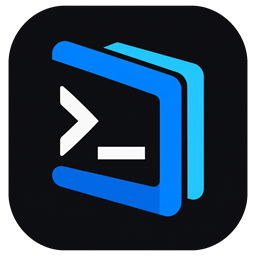

# WindSync

Terminal SSH untuk Windows dan Android dengan vault lokal, pengelolaan server, SFTP, dan monitoring server.

**Gratis digunakan. Kode sumber aplikasi tertutup. Dukungan melalui Ko-fi bersifat sukarela.** Repository ini berisi dokumentasi dan distribusi aplikasi, bukan kode sumber WindSync.

[☕ Traktir pengembang di Ko-fi](https://ko-fi.com/aldymatindev)

## Download

**Rilis publik pertama sedang dipersiapkan.** Belum ada versi stabil yang diumumkan melalui repository ini. Setelah tersedia, unduh installer/APK dari [GitHub Releases](https://github.com/aldyMatin/windsync/releases). Jangan gunakan arsip “Source code” untuk memasang aplikasi; arsip tersebut hanya berisi dokumentasi repository ini.

| Platform | Paket yang akan disediakan |
| --- | --- |
| Windows x64 | Installer `.exe` |
| Android 10+ ARM64/x86_64 | APK release bertanda tangan |

Android 32-bit dan iPhone/iOS belum termasuk distribusi ini. Persyaratan Windows final akan dicantumkan pada catatan rilis setelah pengujian.

## Fitur

- Kelola server SSH, grup, favorit, credential, dan snippet.
- Terminal bertab, pencarian, copy/paste, dan pengaturan tampilan.
- Vault lokal dan backup terenkripsi.
- SFTP untuk transfer serta pengelolaan file remote.
- Monitoring Linux dan Docker melalui koneksi SSH.
- Sesi persisten melalui `tmux` jika tersedia pada server.
- Login Google dan sinkronisasi cloud opsional; lihat batas pada [panduan cloud](docs/CLOUD_SYNC.md).

Fitur dan kompatibilitas mengikuti catatan masing-masing rilis. Beberapa alur perangkat nyata masih dalam validasi; baca [batas yang diketahui](KNOWN_ISSUES.md).

## Panduan dan bantuan

- [Instalasi, update, dan verifikasi download](docs/INSTALLATION.md)
- [Mulai menggunakan WindSync](docs/USER_GUIDE.md)
- [Backup dan pemulihan](docs/BACKUP.md)
- [Sinkronisasi cloud](docs/CLOUD_SYNC.md)
- [Bantuan dan laporan bug](SUPPORT.md)
- [Privasi](PRIVACY.md) · [Ketentuan penggunaan](LICENSE.md) · [Keamanan](SECURITY.md)
- [Dukung pengembangan](SUPPORT_DEVELOPMENT.md)

Jangan sertakan password, private key, token, database, atau backup vault dalam laporan publik.

Untuk pengelola repository: [setup publikasi](MAINTAINER_SETUP.md).
